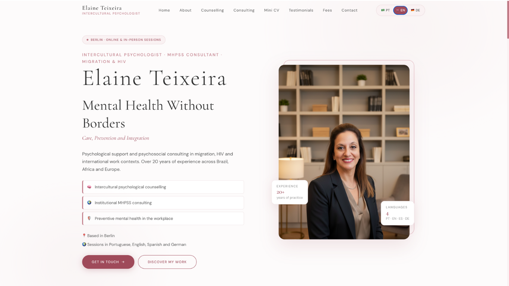

# Elaine Teixeira — Psicóloga Intercultural

<p align="center">
  
</p>

Site institucional (PT/EN, com páginas legais também em DE). React + Vite + TypeScript + Tailwind, 100% estático.

## Stack

| Tecnologia              | Uso                                                      |
|-------------------------|----------------------------------------------------------|
| React 18 + TypeScript   | UI (strict)                                              |
| Vite 5                  | Build e dev server                                       |
| Tailwind CSS            | Estilo, sobre design tokens em CSS variables             |
| react-i18next           | Traduções (idioma vem da URL)                            |
| motion                  | Animações (respeitam `prefers-reduced-motion`)           |
| @emailjs/browser        | Envio do formulário sem backend                          |
| Vitest + Testing Library| Testes                                                   |
| ESLint + Prettier       | Qualidade e formatação                                   |

## Scripts

```bash
npm run dev         # desenvolvimento
npm test            # testes (Vitest)
npm run lint        # ESLint (0 warnings)
npm run typecheck   # tsc --noEmit
npm run build       # tsc + vite build + HTML por rota (SEO)
```

O CI (`.github/workflows/ci.yml`) roda lint, typecheck, testes e build a cada push/PR.

## Estrutura e responsabilidades

```
src/
├── components/
│   ├── layout/      # Header, Footer, LegalPage, NotFound (estrutura da página)
│   ├── sections/    # uma seção da home por arquivo (Hero, Contact, Prices...)
│   └── ui/          # peças reutilizáveis sem regra de negócio (Button, Reveal, ErrorBoundary...)
├── config/          # constantes do site e dados legais (e-mail, WhatsApp, LinkedIn: um lugar só)
├── data/            # dados estáticos (galeria)
├── hooks/           # useLang, useScrolledPast, useActiveSection
├── i18n/            # catálogos pt/en/de + init
├── legal/           # textos de privacidade e impressum
├── lib/             # lógica SEM UI: paths (rotas puras), route (navegação), consent,
│                    # analytics, contactForm (validação + envio + erros), seo, logger
├── pages/           # Home
├── styles/          # globals.css (tokens, base)
└── test/            # setup do Vitest
scripts/postbuild-seo.mjs   # gera HTML estático por rota + sitemap/robots
```

Regra de dependência: `components` → `hooks`/`lib`/`config`; `lib` nunca importa de `components`.

## Variáveis de ambiente

Copie `.env.example` para `.env` e preencha as chaves do EmailJS (`VITE_EMAILJS_*`).
Sem elas o formulário mostra uma mensagem de "indisponível" com o e-mail direto (não quebra).

## Responsividade

Testado de 320 px (celular) a 3840 px (telão). Abaixo de 1920 px o `rem` é 16 px; acima disso a
fonte-raiz acompanha a viewport e todo o layout (em `rem`) escala junto. Alvos de toque ≥ 44 px em telas
de toque; botões flutuantes respeitam a área segura do iPhone.

## Texto e idiomas

Edite `src/i18n/pt.json` e `en.json`. Para um novo idioma: crie o JSON, registre em `src/i18n/i18n.ts` e
na tabela `PATHS` de `src/lib/paths.ts` (o script de SEO usa a mesma tabela).
